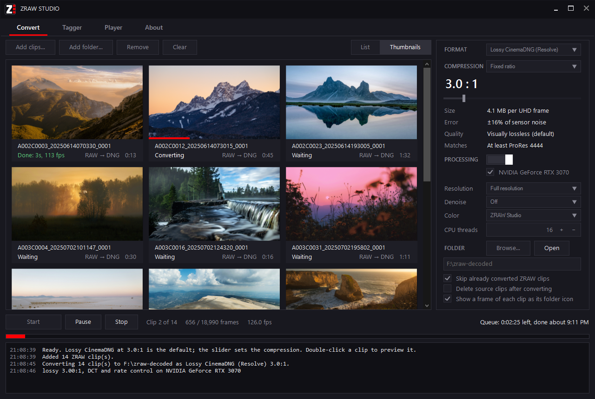

<div align="center">

# ZRAW Studio




</div>

---

ZRAW Studio converts Z CAM ZRAW footage into files DaVinci Resolve and other editors can open, and lets Windows show and play ZRAW clips. Drop your clips on the window and press Start.

- Converts 4K ZRAW to CinemaDNG at up to 130 frames per second on an RTX 3070.
- Shrinks files to a quarter of their uncompressed size with no visible loss.
- Cleans up noise in the raw Bayer data before converting.
- Takes clips, folders or a whole memory card by drag and drop.
- Shows ZRAW thumbnails and previews in File Explorer.
- Plays ZRAW clips at full 4K in the free [mpv](https://mpv.io/installation/) player.
- Uses your graphics card, or several at once.
- Renames ZRAW clips so they stand apart from H.265 clips.
- Handles both Bayer ZRAW and H.265 ZRAW.
- Gets color right with calibration measured on a Z CAM E2.
- Comes as one portable `.exe` with nothing to install.

> [!NOTE]
> Compression, color, denoise and resolution settings only apply to Bayer ZRAW. H.265 ZRAW is already processed by the camera, so ZRAW Studio copies its video unchanged.

---

## Download

Get `ZRAW Studio.exe` from the [latest release](https://github.com/wearyfax/ZRAW-Studio/releases/latest) and run it. The first time, Windows may say it protected your PC because the app is new and unsigned. Click **More info**, then **Run anyway**.

You need:

- Windows 10 or 11, 64-bit
- A processor with AVX2: Intel Core 4th generation or newer, or AMD Ryzen or newer
- For GPU acceleration: a DirectX 11 graphics card
- For H.265 ZRAW thumbnails and previews: Microsoft's [HEVC Video Extensions](https://apps.microsoft.com/detail/9nmzlz57r3t7)
- To play ZRAW clips: [mpv](https://mpv.io/installation/), a free video player. The ZRAW plugin runs inside mpv, so install mpv first.

On Linux, you can build the command-line converter yourself and convert on a server. See [Linux](#linux).

## Using it

1. Drop your clips, or the card's `DCIM` folder, anywhere on the Convert tab.
2. Check the folder on the right. By default the files go to `zraw-decoded` at the root of the drive the clips are on.
3. Press **Start**.

Each Bayer clip becomes a folder of DNG files plus a `.mov` with the audio and timecode. Drag the folder into DaVinci Resolve.

To see ZRAW thumbnails in File Explorer, open the **Tagger** tab and click **Install thumbnail engine**.

Playing ZRAW clips needs [mpv](https://mpv.io/installation/). ZRAW Studio's plugin teaches mpv to read ZRAW, so install mpv first, then open the **Player** tab and click **Install plugin**. After that, mpv plays ZRAW clips like any other video.

The **About** tab shows your version, checks for updates and opens the log folder. If something goes wrong, attach the newest log file to an [issue](https://github.com/wearyfax/ZRAW-Studio/issues).

В ZRAW Studio встроен русский перевод: на русской Windows он включается сам, а сменить язык можно на вкладке «О программе».

---

## More about the features

### Speed and file size

The default 3:1 CinemaDNG takes about 4 MB per 4K frame, against 6.9 MB for lossless and 16.6 MB uncompressed. Its compression error is about a sixth of the noise the sensor already records, which is why it looks the same as lossless. Lossless and uncompressed CinemaDNG are there when you want them.

Compression runs on the GPU. With more than one graphics card you can tick several to share the work, and without a suitable GPU ZRAW Studio uses the CPU.

### Fixed ratio or fixed quality

The Compression menu on the Convert tab has two modes:

- **Fixed ratio** (the default) compresses every frame by the same amount. At 3:1 the result looks the same as lossless. For the highest quality, use fixed ratio.
- **Fixed quality** sizes each shot from its ISO and content to reach a chosen level, named after the ProRes or E2 H.265 setting it matches. The files come out about the same size on average, but at the higher compression levels some shots can show compression artifacts.

### Denoise

Denoise works on the raw Bayer data, on the GPU, before the DNGs are written. Each frame is merged with its neighbors using the camera's measured noise at the clip's ISO, and anything that moves keeps its own pixels, so nothing ghosts. Light takes out more than half the noise without softening edges, and Strong merges more frames. Denoise works best on tripod and gimbal shots, and conversion runs at about half speed with it on.

### Color

The default color matrices come from spectrophotometer measurements of a Z CAM E2 and follow each shot's color temperature. You can also pick Z CAM's factory matrices (the ones zraw-parser writes), the matrices the camera stores in every frame, or the ZRAW VideoSuite matrix. DaVinci Resolve's Highlight Recovery works on the converted files.

### Bayer ZRAW and H.265 ZRAW

Z CAM firmware before 0.94, and patched firmware, records Bayer ZRAW, which ZRAW Studio converts to CinemaDNG. Firmware 0.94 and later records H.265 ZRAW, which becomes a standard H.265 `.mov` in seconds, with no re-encoding.

The Type column, and the line under each thumbnail, says what a clip holds: ZRAW Bayer 12-bit, ZRAW Bayer 14-bit or ZRAW H.265 10-bit. ZRAW Studio reads the pixels to decide, so a clip whose header says 14-bit but whose data is only 12-bit shows as 12-bit. Every output format keeps true 14-bit: lossless and uncompressed store all 14 bits, and lossy keeps the extra precision in the shadows. A 14-bit file that only holds 12-bit data is written as 12-bit, which saves about a sixth of the space in lossless. Recorded in the camera's low-noise mode, 14-bit footage has about a third less noise in the shadows than standard 12-bit.

### Renaming clips

The camera gives ZRAW and H.265 recordings the same `.MOV` name. The Tagger tab finds the ZRAW clips by their contents and adds a `ZRAW_` prefix, and it can undo that too.

---

## License

ZRAW Studio is free software under the [GNU General Public License v2](LICENSE). Bundled third-party code is listed in [third_party/README.md](third_party/README.md).

ZRAW Studio is an independent project and is not affiliated with or endorsed by Z CAM.

## Building from source

You need Windows 10 or 11, [Git](https://git-scm.com/), and the free [Build Tools for Visual Studio 2022](https://visualstudio.microsoft.com/downloads/#build-tools-for-visual-studio-2022) with the **Desktop development with C++** workload. The C# part compiles with the .NET Framework compiler built into Windows.

```bat
git clone https://github.com/wearyfax/ZRAW-Studio.git
cd ZRAW-Studio
build.bat
```

The first build downloads the ReaLTaiizor UI library from NuGet. The result is `bin\ZRAW Studio.exe`. The build also leaves the command-line converter, `bin\zrawdng.exe`, in the same folder; run it without arguments to see its options.

### Linux

The converter also builds on Linux x86-64, for converting on a headless server without the app. On Linux it runs on the CPU only; GPU acceleration, denoise, playback and thumbnails need Windows. You need g++ (tested with version 13) and a processor with AVX2.

```sh
git clone https://github.com/wearyfax/ZRAW-Studio.git
cd ZRAW-Studio
sh build.sh
bin/zrawdng convert /path/to/DCIM -o /path/to/output
```

Run `bin/zrawdng` without arguments to see the options. Lossless output from Linux and Windows is identical, byte for byte.

### Source folders

| Folder | Contents |
|---|---|
| `app\` | The Windows app (C#) |
| `engine\` | The converter, the preview library and the mpv plugin (C++) |
| `explorer\` | The File Explorer add-on for thumbnails and previews (C++) |
| `third_party\` | Libraries from other projects |

## Thanks

ZRAW Studio is built on the work of [storyboardcreativity](https://github.com/storyboardcreativity), author of [zraw-parser](https://github.com/storyboardcreativity/zraw-parser), [zraw-decoder-lib](https://github.com/storyboardcreativity/zraw-decoder-lib) and [tiny-mov-library](https://github.com/storyboardcreativity/tiny-mov-library). The ZRAW decoder here is a port of zraw-decoder-lib, and the converted folders use zraw-parser's layout. Thank you.
